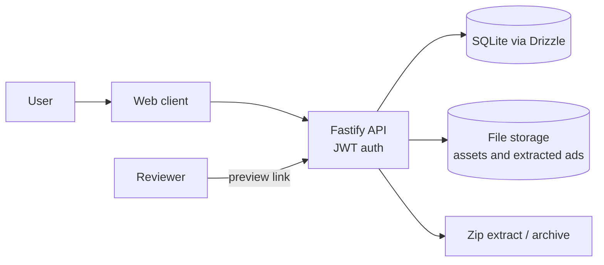

# TheSign 360: Creative Asset Management and HTML Ad Hosting

> **Architecture case study.** Source code is private and owned by the client. This repository contains original documentation only: no client code, data, credentials or assets.

## Architecture

## Problem

A brand studio needed a controlled place to store creative assets and to host HTML5 ad packages for review and delivery, without sending zip files around by email.

## Solution

A client and server application where users upload creative assets and zipped HTML ads; the server unpacks, stores and serves them behind authentication, and can package assets for download.

## Modules

- **Asset library**: upload, organise, preview
- **Ad hosting**: upload zipped HTML5 ads, serve preview links
- **Packaging**: bundle assets for download
- **Access**: users, roles, token-based sessions

## Tech stack

- TypeScript monorepo (npm workspaces: client and server)
- Fastify server with JWT auth, multipart upload and static serving
- Drizzle ORM with SQLite and versioned migrations
- Zip handling for ad packages (extract and archive)

## Key design decisions

1. A small, self-contained stack (Fastify + SQLite) keeps hosting simple and cheap for the workload.
2. Uploaded HTML ad bundles are extracted server-side and served from controlled paths, not executed from user-supplied locations.
3. Database schema changes go through generated, versioned migrations.
4. Passwords are hashed and API access uses signed tokens.

---

Designed and delivered by [Adil Ahmed](https://github.com/AdilAhmedAhir) at [Start Daily xyz Limited](https://startdaily.xyz), Dhaka.
